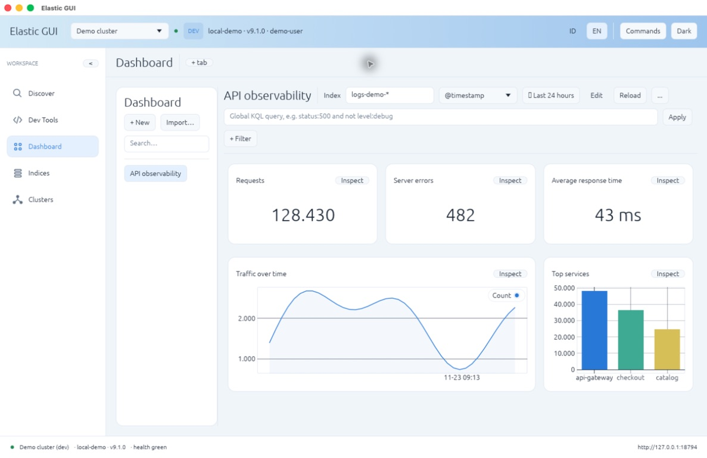
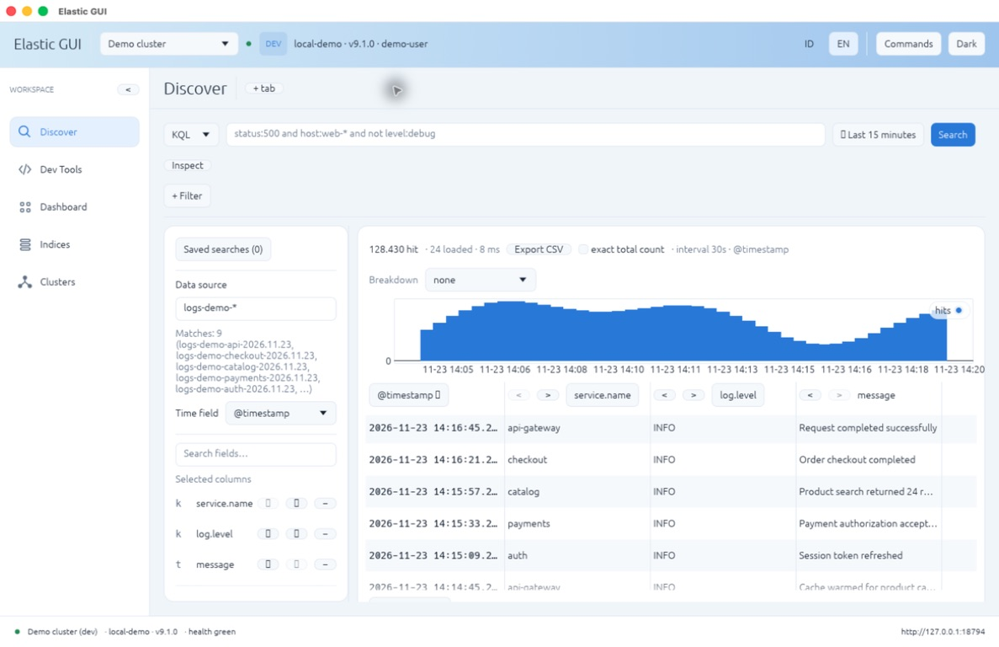
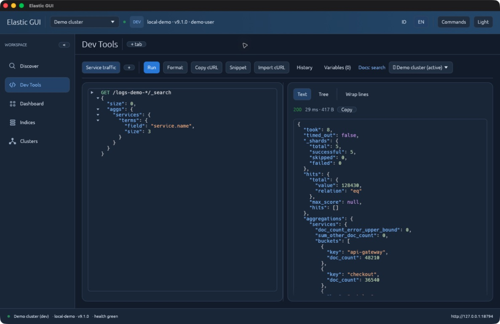
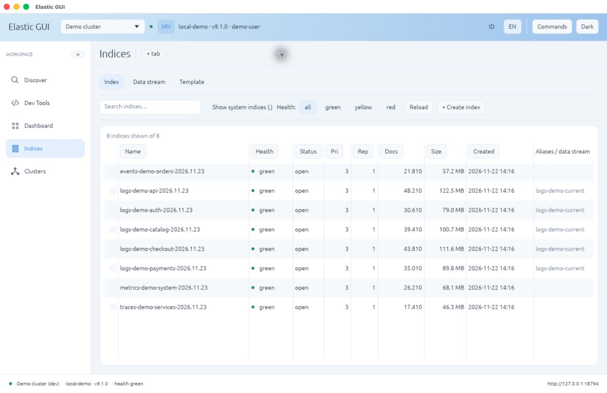

# Elastic GUI

[](https://github.com/simenglabs/elastic-gui/actions/workflows/ci.yml)
[](https://github.com/simenglabs/elastic-gui/releases/latest)

A native desktop workspace for Elasticsearch. Explore documents, run API requests, build dashboards, and manage indices across multiple clusters.

Built with Rust and [egui](https://github.com/emilk/egui). Connect directly to Elasticsearch without deploying a separate web interface.

## Download

Requires **macOS 13 or later**.

| Mac | Latest installer |
| --- | --- |
| Apple Silicon (M-series) | [Download DMG](https://github.com/simenglabs/elastic-gui/releases/latest/download/Elastic-GUI-macos-arm64.dmg) |
| Intel | [Download DMG](https://github.com/simenglabs/elastic-gui/releases/latest/download/Elastic-GUI-macos-x86_64.dmg) |

Open the DMG and drag **Elastic GUI.app** into **Applications**. Previous versions and SHA-256 checksums are available on the [Releases page](https://github.com/simenglabs/elastic-gui/releases).

The app is ad-hoc signed and is not yet notarized by Apple. On first launch, macOS may require approval under **System Settings → Privacy & Security → Open Anyway**.

## Why Elastic GUI?

- **Keep cluster context.** Switch between clusters while retaining each workspace's queries and module state. Pin cluster/module combinations as tabs.
- **Move from data to requests.** Use Inspect actions to open the underlying request in Dev Tools, then edit and rerun it.
- **Use production controls.** Environment labels, read-only profiles, and confirmation dialogs help distinguish routine inspection from destructive operations.
- **Keep credentials out of exports.** Passwords, API keys, and bearer tokens use the OS keychain. Profile exports omit secrets, and copied cURL commands redact credentials.
- **Work in one desktop app.** Search, API editing, dashboards, and index administration share the same connection profiles, with light/dark themes and English/Indonesian UI options.

## Screenshots

Screenshots show the running app with synthetic data from a local mock Elasticsearch server.

**Dashboard:** request counts, response times, traffic trends, and service breakdowns.



<details>
<summary>Discover: search and inspect documents</summary>



</details>

<details>
<summary>Dev Tools: edit requests and inspect JSON responses</summary>



</details>

<details>
<summary>Indices: review health, document counts, and storage</summary>



</details>

## What you can do

| Workspace | Features |
| --- | --- |
| **Discover** | Search indices, aliases, and data streams with KQL, Lucene, JSON DSL, or ES\|QL. Filter by time and fields, zoom into histograms, choose columns, inspect documents, save searches, and export CSV. |
| **Dev Tools** | Write multiple requests with syntax highlighting, API and field autocomplete, JSON folding, formatting, history, variables, snippets, and cURL import/export. View responses as text or a JSON tree. |
| **Dashboard** | Combine metrics, time series, category charts, pie/donut charts, tables, Markdown, and saved searches. Apply shared queries, time ranges, and filters; import or export dashboards as JSON. |
| **Indices** | Inspect index health, shards, aliases, storage, mappings, and settings. Manage indices, data streams, and templates, including administrative operations with confirmations where applicable. |
| **Clusters** | Save connection profiles with Basic, API key, or Bearer authentication. Configure custom CAs, certificate fingerprints, mTLS, proxies, headers, timeouts, and multiple nodes for failover or round-robin access. |

Autocomplete specifications cover Elasticsearch **7, 8, and 9**. Available features depend on the cluster version and deployment type; ES|QL requires Elasticsearch 8.11+ or Serverless.

## Get started

1. Open **Clusters** and create a profile with your node URL and authentication details.
2. Select the environment, use **Test connection**, then **Save** and **Use** the profile.
3. Open **Discover** and choose a data source, or start with a request in **Dev Tools**.

Profiles, console history, tabs, saved searches, and dashboards are stored in the OS application-data directory. On macOS this is `~/Library/Application Support/id.MengLabs.elastic-gui/`. If the OS keychain is unavailable, credentials remain in memory for the current session.

| Shortcut | Action |
| --- | --- |
| `Cmd/Ctrl + K` | Open the command palette |
| `Cmd/Ctrl + Enter` | Run the current request or selected requests |
| `Ctrl + Space` | Open autocomplete suggestions |
| `Cmd/Ctrl + I` | Format the current JSON request |

## Build from source

Install [Rust stable](https://rustup.rs/) and the native build prerequisites:

- **macOS:** Xcode Command Line Tools (`xcode-select --install`).
- **Windows:** the Rust MSVC toolchain and Visual Studio Build Tools with Desktop development with C++.
- **Ubuntu/Debian:** `build-essential pkg-config libx11-dev libxkbcommon-dev libwayland-dev libgl1-mesa-dev libdbus-1-dev`. A Secret Service provider such as GNOME Keyring or KWallet is needed to persist credentials.

```sh
git clone https://github.com/simenglabs/elastic-gui.git
cd elastic-gui
cargo run --locked
```

You can also create a temporary connection profile from environment variables:

```sh
ELASTIC_URL=http://localhost:9200 cargo run --locked
```

Set `ELASTIC_USER` and `ELASTIC_PASSWORD` for Basic authentication, or `ELASTIC_API_KEY` for API key authentication. Separate multiple node URLs with commas. This profile is not saved unless you save it in the app.

<details>
<summary>Development checks, packaging, and releases</summary>

Run the checks used by CI:

```sh
cargo fmt --check
cargo clippy --locked --all-targets -- -D warnings
cargo test --locked
cargo build --locked --release
```

Live-cluster and performance tests are ignored by default. Performance checks can be run with `cargo test --release -- --ignored perf --nocapture`. Set `ELASTIC_GUI_TIMING=1` when launching the binary to print first-frame timing and process memory usage on macOS/Linux.

To build a DMG on an Apple Silicon Mac:

```sh
MACOSX_DEPLOYMENT_TARGET=13.0 cargo build --locked --release
python3 tools/package_macos.py --target aarch64-apple-darwin
```

On an Intel Mac, use `--target x86_64-apple-darwin`. The packager verifies the binary architecture, creates and ad-hoc signs the app bundle, verifies the DMG, and writes a SHA-256 checksum to `dist/`.

GitHub Actions runs these checks and builds both DMGs for pushes and pull requests to `main`. CI artifacts remain available for 14 days. You can also start CI manually from the Actions tab.

To publish a release, update the version in `Cargo.toml` and `Cargo.lock`, commit and push to `main`, then push a matching tag:

```sh
git tag -a v0.1.1 -m "Release v0.1.1"
git push origin v0.1.1
```

The release workflow validates the version, builds both architectures, checks the downloads' checksums, and publishes a GitHub Release. Asset names stay fixed so the download links above follow the latest stable release. Tags with a prerelease suffix are published as prereleases.

</details>
